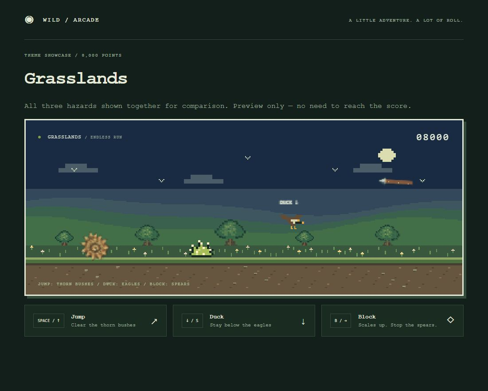
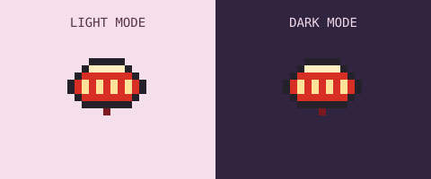
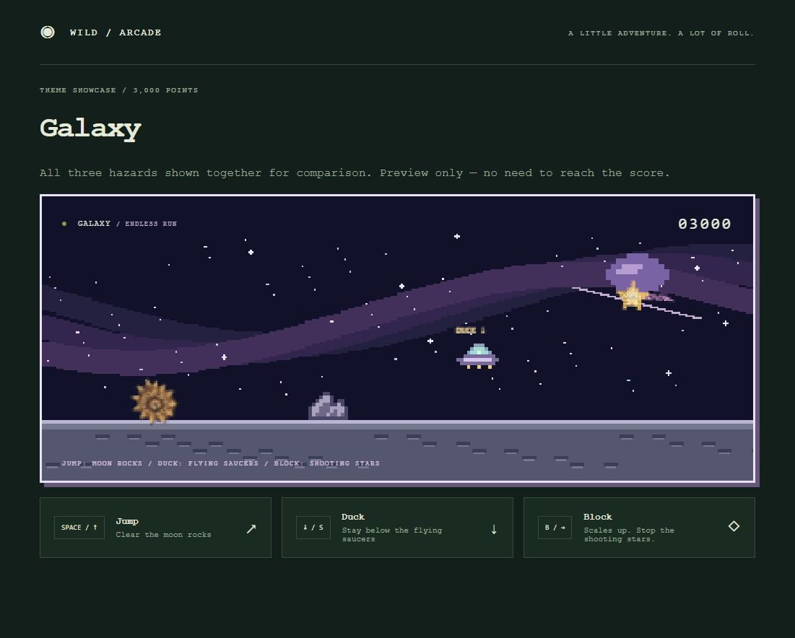
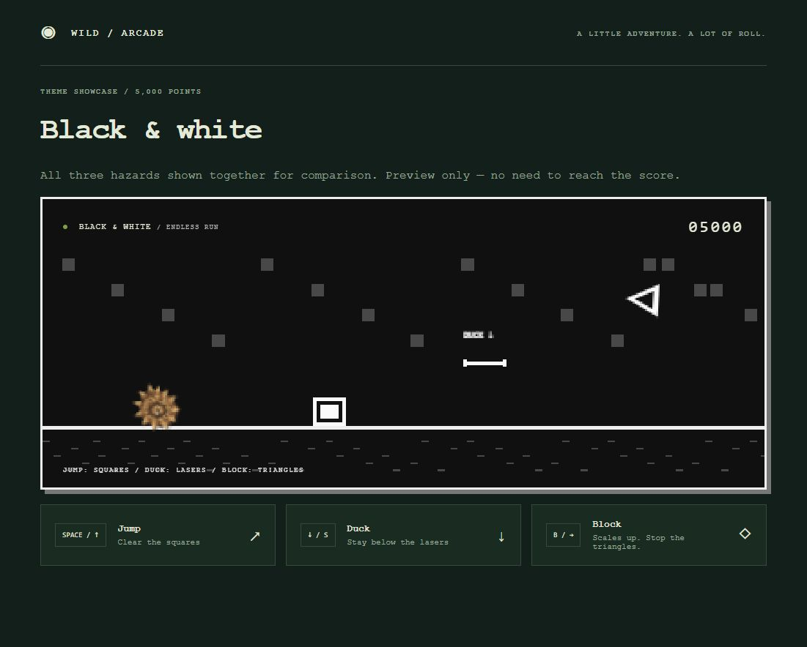

# Pangolin Run

A browser endless runner with a rolling pangolin, original retro pixel artwork, keyboard and touch controls, and changing biomes.

[Play the game](https://pangolin-run-sonderence.zippyfairy18.chatgpt.site/)

## Download and play — no installation

**[Download Pangolin Run ZIP](https://github.com/Sonderence/pangolin-run/releases/latest/download/pangolin-run.zip)**

1. Download the ZIP above, or open [Releases](https://github.com/Sonderence/pangolin-run/releases/latest) and choose **pangolin-run.zip** under **Assets**.
2. **Extract the entire ZIP**: on Windows, right-click it and choose **Extract All**; on macOS, double-click the ZIP.
3. Open the extracted folder and double-click **index.html** to launch the game in your browser.
4. Press **Space** or click **Let’s roll** to start.

Keep all the extracted files together. Open the extracted `index.html`, not the file inside the ZIP preview. A `START-HERE.txt` file with these instructions is included.

No account, installation, web server or internet connection is required to play after downloading. Conservation links need internet access. Best-score saving depends on your browser allowing local storage for local files.

### For developers

If you downloaded the repository source ZIP instead of the ready-to-play release, open **dist/index.html**. No build step is required. You can also serve `dist` with any static HTTP server.

## Controls

| Action | Keyboard | Purpose |
| --- | --- | --- |
| Jump | Space, Up, W | Clear ground hazards |
| Duck / crawl | Hold Down or S | Pass flying hazards |
| Block | Hold B or Right | Stop curved projectiles while grounded |
| Pause / resume | P, Escape, or Pause button | Take a break |

Touch controls appear below the game. The game pauses when the window loses focus. Best scores are saved locally in browser storage.

## Progression

Bushes appear first, flying hazards unlock at 150 points, and curved projectiles at 500. Ground hazards and projectiles do not coexist in the active obstacle list.

| First appearance | Biome | Jump | Duck | Block |
| --- | --- | --- | --- | --- |
| 0 | Grasslands | Thorn bushes | Eagles | Spears |
| 1,000 | Cherry blossoms | Japanese paper lanterns | Snowy owls | Arrows |
| 3,000 | Galaxy | Moon rocks | Flying saucers | Shooting stars |
| 5,000 | Black & white | Squares | Lasers | Triangles |
| 8,000 | Grasslands returns | Thorn bushes | Eagles | Spears |

After 8,000 points, an 11,000-point cycle repeats: grasslands for 1,000 points, cherry blossoms for 2,000, galaxy for 5,000, and black & white for 3,000. The next transitions are 9,000, 11,000, 16,000 and 19,000.

Gradual acceleration is supplemented by speed boosts at 300, 800, 1,500, 3,000, 5,000 and 8,000 points. All speed increases stop after 8,000.

Scores use `Math.round(distance * 0.025)`, following the Chromium dinosaur runner distance convention. Artwork and implementation are original. [Scoring reference](https://chromium.googlesource.com/chromium/src/+/refs/tags/98.0.4758.55/components/neterror/resources/offline.js).

## Theme showcases

Open `dist/theme-preview.html?theme=grasslands` through a local server, replacing the theme with `blossom`, `galaxy` or `mono`. These show all three hazards together for comparison; they do not represent normal obstacle spawning.

Hosted previews: [grasslands](https://pangolin-run-sonderence.zippyfairy18.chatgpt.site/theme-preview?theme=grasslands), [cherry blossoms](https://pangolin-run-sonderence.zippyfairy18.chatgpt.site/theme-preview?theme=blossom), [galaxy](https://pangolin-run-sonderence.zippyfairy18.chatgpt.site/theme-preview?theme=galaxy), [black & white](https://pangolin-run-sonderence.zippyfairy18.chatgpt.site/theme-preview?theme=mono).

### Grasslands

Thorn bushes, eagles and spears.

### Cherry blossoms

Japanese paper lanterns, snowy owls and arrows.

The ground hazard is a red Japanese paper lantern with a dark outline and warm cream ribs for contrast against pink scenery. Jump over it; snowy owls and arrows keep their existing controls.

### Galaxy

Moon rocks, flying saucers and shooting stars.

### Black & white

Squares, lasers and triangles.

## Source

- `dist/index.html`: main page and sourced conservation information
- `dist/style.css`: responsive layout and browser light/dark themes
- `dist/game.js`: gameplay, physics, scoring and artwork
- `dist/theme-preview.html` and `dist/theme-preview.js`: theme showcases

Syntax check: `node --check dist/game.js`.

The GitHub repository stores the source. The existing Sites deployment is managed separately; pushing here does not automatically update the hosted game.

## Conservation

The page contains independently written summaries with links to ZSL and IUCN. The game is not affiliated with or endorsed by those organisations. Rolling to travel and blocking projectiles are fictional gameplay behaviours.
